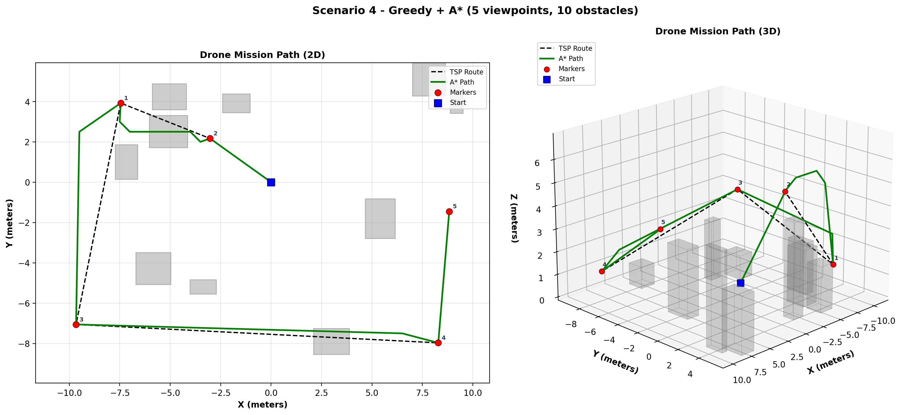
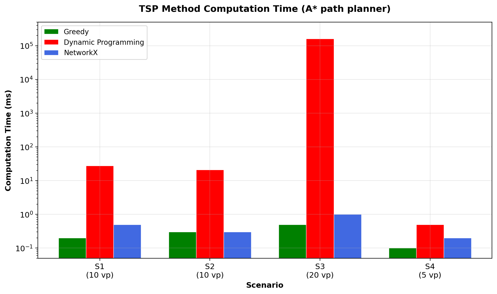
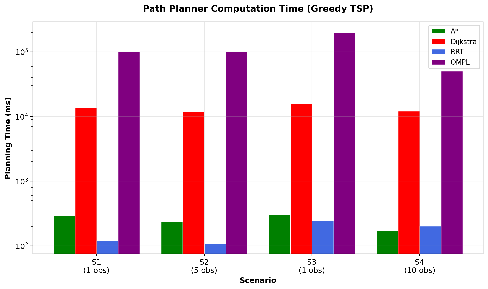
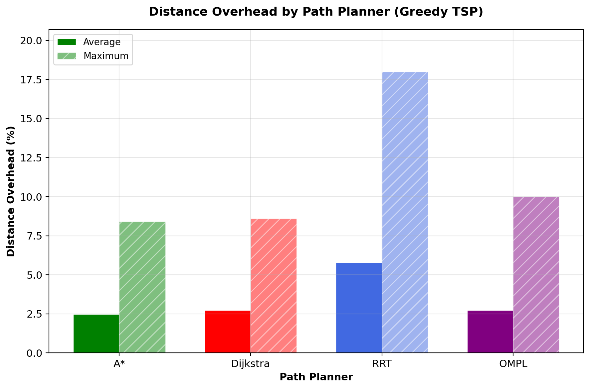
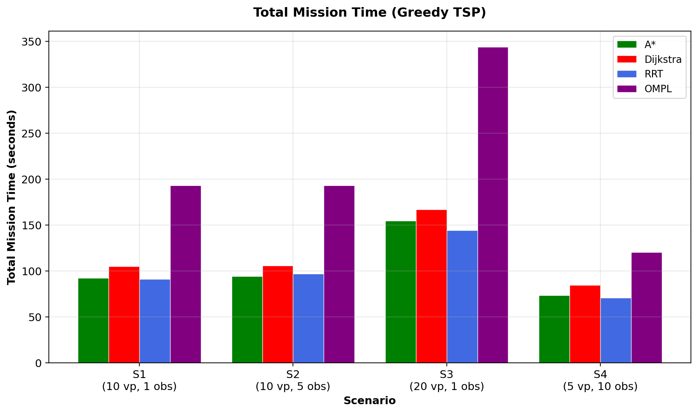
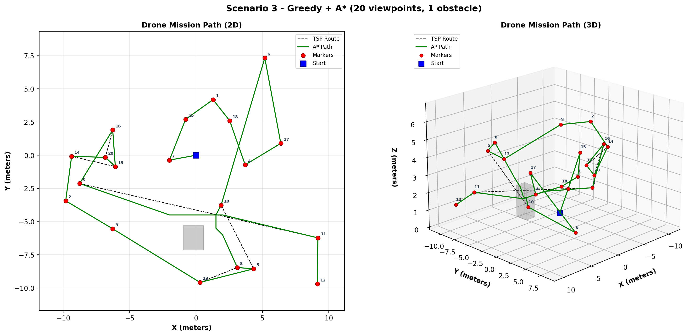

# Aerial Inspection Path Planning

This repository contains the code to plan and fly a **structural inspection mission** with a simulated drone in **Aerostack2** (ROS 2 Humble, Gazebo). The drone visits every viewpoint of a scenario, photographs the ArUco marker at each one and avoids the cuboid obstacles on the way.

The mission is split into two problems that are solved and compared separately:

* the **visiting order** of the viewpoints, a travelling salesman problem solved by Greedy nearest-neighbour, Held–Karp dynamic programming or the NetworkX approximation;
* the **collision-free path** between consecutive viewpoints, planned by A*, Dijkstra, RRT or RRT* (OMPL).

Every combination was flown on four scenarios, 48 runs in total, and every run verified all of its markers. The recommended configuration is **Greedy with A***: sub-millisecond tours, planning in under a third of a second, the lowest path overhead of the four planners and the same path on every run.

The full write-up is in [report.pdf](./report.pdf). Developed for Coursework 1 of the UCL module *COMP0240: Aerial Robotics: Fundamentals to Practice in Real-World Environments* (2026).



## Repository structure

* `mission_scenario.py` — the mission: TSP solvers, path planners, path smoothing, ArUco verification and logging;
* `plot_graph_compare.py` — the five comparison figures from `results/comparison_results.csv`;
* `plot_trajectory_compare.py` — the 2D and 3D trajectory figure for one run;
* [results](./results/) — the scored table of all 48 runs and the flown trajectory of each;
* [figures](./figures/) — the figures of the report;
* [report.pdf](./report.pdf) — the coursework report.

## Built on

This repository contains **only the files written for this coursework**. It runs inside the course template [challenge_mission_planning](https://github.com/UCL-MSC-RAI-COMP0240/challenge_mission_planning) (BSD-3, Aerostack2 developers and UCL), which provides the simulator launch files, the four scenarios and the Gazebo worlds. `mission_scenario.py` replaces the template's file of the same name and keeps its licence header.

* [Aerostack2](https://github.com/aerostack2/aerostack2) — the drone framework and the `follow_path` behaviour;
* [python-tsp](https://github.com/fillipe-gsm/python-tsp) — the Held–Karp solver;
* [NetworkX](https://networkx.org/) — the approximate TSP;
* [OMPL](https://ompl.kavrakilab.org/) — the RRT* planner;
* [OpenCV](https://opencv.org/) — ArUco detection.

## Method

The planner works on a 3D occupancy grid of 0.5 m cells covering ±20 m in x and y and 0–15 m in z. Each obstacle is inflated by 1.0 m on every side.

* The TSP runs on straight-line distances between the start and the viewpoints.
* A* and Dijkstra search the grid with a 26-connected neighbourhood. A* uses the Euclidean distance as its heuristic and Dijkstra uses none, so Dijkstra is the baseline that shows what the heuristic saves.
* RRT samples the continuous space with a 0.5 m step, a 10% goal bias and at most 5000 iterations. RRT* comes from OMPL with a 10 s budget per segment.
* A line-of-sight pass then removes every waypoint the drone can skip without a collision, checking 21 points along each shortcut.
* The path is flown with `follow_path` at 1.0 m/s, facing the marker. At each viewpoint the camera has 3 s to detect an ArUco marker (`DICT_5X5_250`).

The distance overhead is how much longer the flown path is than the straight-line TSP tour.

## Results

The scenarios: scenario 1 has 10 viewpoints and 1 obstacle, scenario 2 has 10 viewpoints and 5 obstacles, scenario 3 has 20 viewpoints and 1 obstacle, and scenario 4 has 5 viewpoints and 10 obstacles. All 48 runs reached every viewpoint and verified every marker.

| TSP solver (A* planner) | Greedy | Held–Karp (DP) | NetworkX |
|---|---|---|---|
| TSP time | 0.1–0.5 ms | 21–28 ms at 10 viewpoints, 160.9 s at 20 | 0.2–1.0 ms |
| Tour, scenario 3 | 99.8 m | 80.4 m | 99.8 m |

| Planner (Greedy TSP) | Planning time | Mean overhead | Worst overhead |
|---|---|---|---|
| A* | 0.17–0.30 s | 2.5% | 8.4% |
| Dijkstra | 11.9–15.8 s | 2.7% | 8.6% |
| RRT | 0.11–0.25 s | 5.8% | 18.0% |
| RRT* (OMPL) | 50–201 s | 2.7% | 10.0% |

Planning times are the totals over all segments of a mission.

Held–Karp only pays off on scenario 3, where its tour is 19.4% shorter, but it needs 160.9 s to find it, longer than the whole Greedy + A* mission of 154.6 s. NetworkX returned the same tours as Greedy in every scenario. A* plans 47–71 times faster than Dijkstra with the same path quality, and unlike RRT and RRT* it gives the same path on every run. RRT*'s optimality guarantee bought nothing on this bounded grid: it came close to A*'s path quality, 2.7% against 2.5% mean overhead, at 290 to 660 times the planning time.

| | |
|---|---|
|  |  |
|  |  |



Every run is listed in `results/comparison_results.csv`.

## Running

Set up the ROS 2 workspace and the template as described in the [template README](https://github.com/UCL-MSC-RAI-COMP0240/challenge_mission_planning), then copy the three Python files of this repository into the template folder, replacing its `mission_scenario.py`. Install the Python dependencies:

```
pip install -r requirements.txt
```

OMPL needs its Python bindings, from the OMPL installer or a ROS package.

Fly a mission, one terminal each:

```
./launch_as2.bash -s scenarios/scenario1.yaml
./launch_ground_station.bash
python3 mission_scenario.py scenarios/scenario1.yaml --tsp greedy --path astar
```

`--tsp` takes `greedy`, `dp` or `networkx`, and `--path` takes `astar`, `dijkstra`, `rrt` or `ompl`. Each run appends a row to `results/comparison_results.csv` and writes its trajectory to `results/trajectory_<scenario>_<tsp>_<path>.csv`.

Plot the results:

```
python3 plot_graph_compare.py
python3 plot_trajectory_compare.py scenarios/scenario1.yaml -t results/trajectory_scenario1_greedy_astar.csv -o figures/fig6_trajectory_s1.png
```

`plot_graph_compare.py` writes `fig1`–`fig5` to the folder it is run from. The plotting scripts need only the `results/` folder and the scenario files, not ROS.

## Author

Amir Gerges, MSc Robotics and Artificial Intelligence, UCL.
